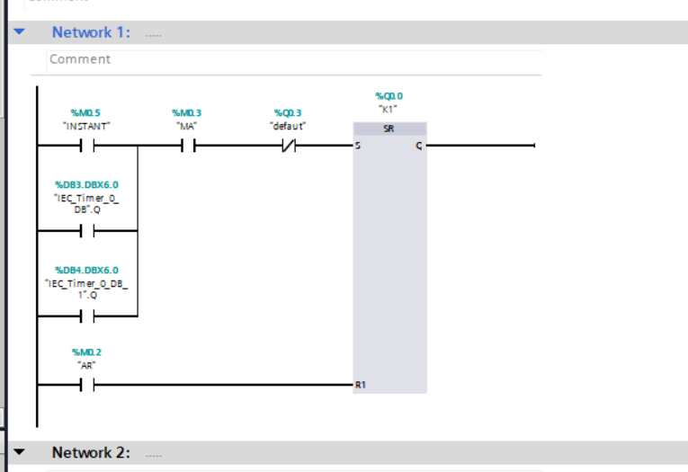
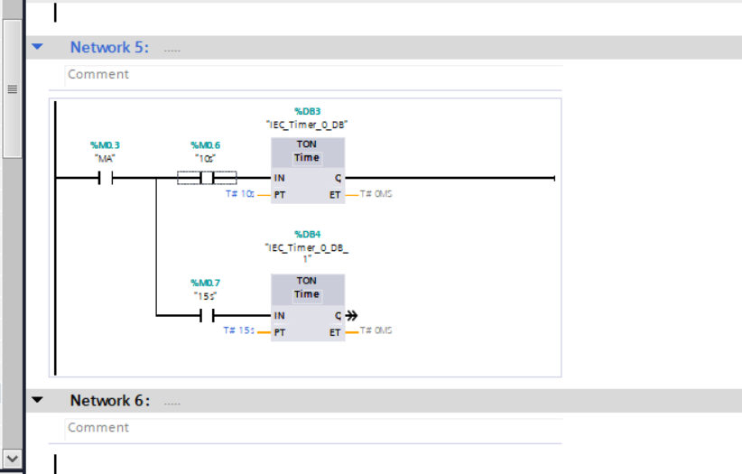
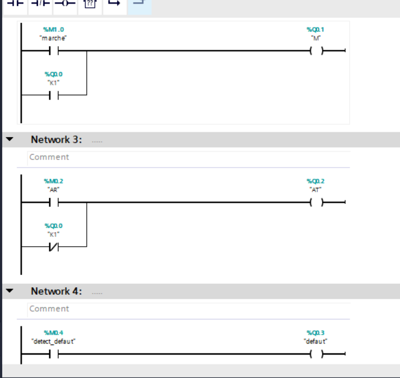
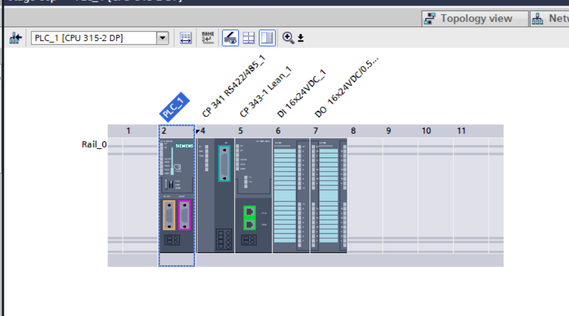
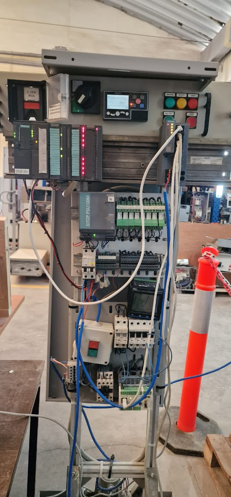
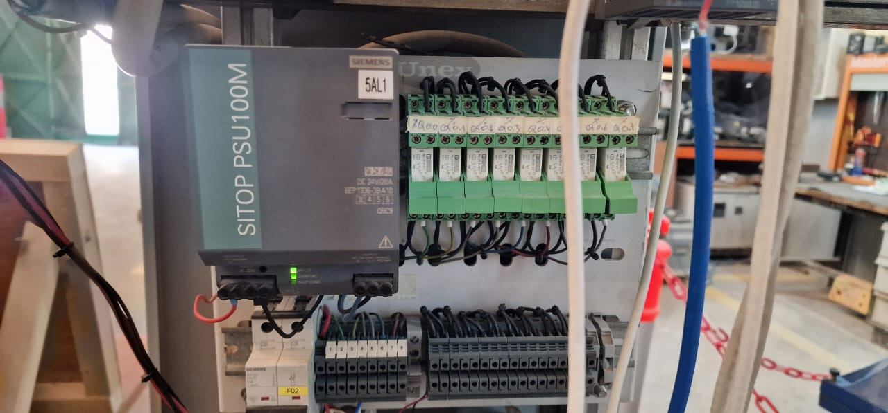
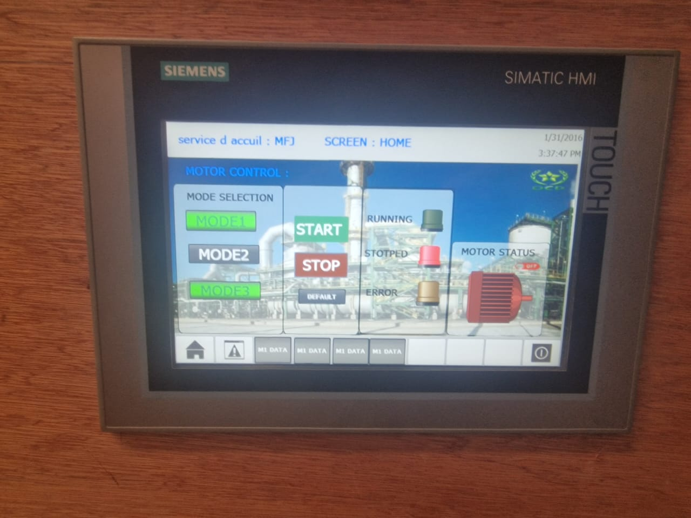
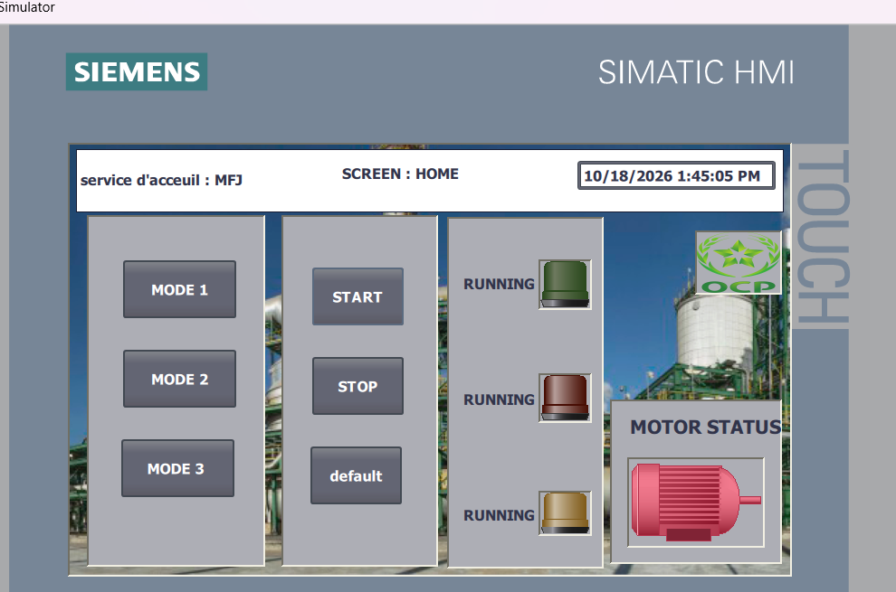

# Siemens S7-300 Motor Control with WinCC HMI

Motor control and HMI work developed during an internship at **OCP Jorf Lasfar**. This repository documents a Siemens S7-300 hardware configuration, a TIA Portal Ladder Diagram (LAD) control program, and a WinCC operator interface.

## Control logic

- Three mutually exclusive start modes: **INSTANT**, **10 s**, and **15 s**. The delayed modes use TON timers before the motor run command is set.
- **START** and **STOP** commands with an SR latch for the run command.
- Fault blocking and status indication for running, stopped, and fault conditions.

## PLC configuration and cabinet

The TIA Portal rack configuration uses a **SIMATIC S7-300 CPU 315-2 DP** with a **CP 341 RS422/485**, **CP 343-1 Lean**, **DI 16 × 24 VDC**, and **DO 16 × 24 VDC**.

The internship cabinet photographs show Siemens PLC equipment, a **SITOP PSU100M** power supply, interface relays, and physical controls. They provide physical context for the work; the photographed cabinet is not presented as an exact module-for-module match to the TIA Portal rack view.

## Operator interface

The physical **SIMATIC HMI** and **WinCC simulator** screens show mode selection, START/STOP controls, and motor status and fault indicators.

The images document the control concept and interface; they do not serve as a commissioning record or establish production deployment.
